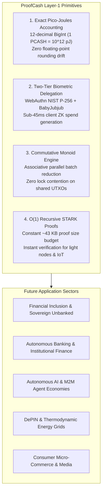
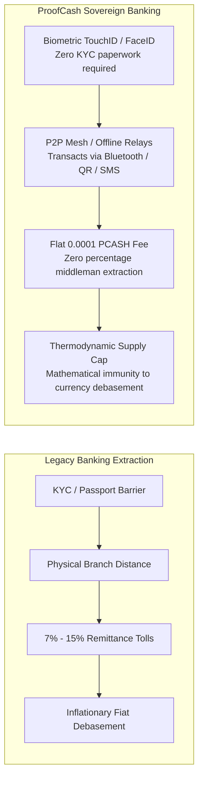
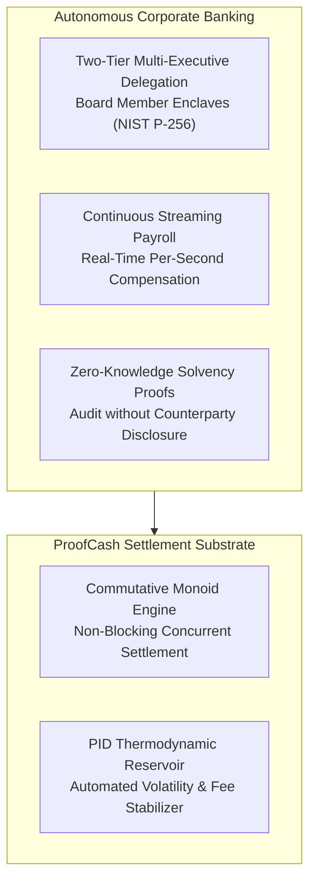
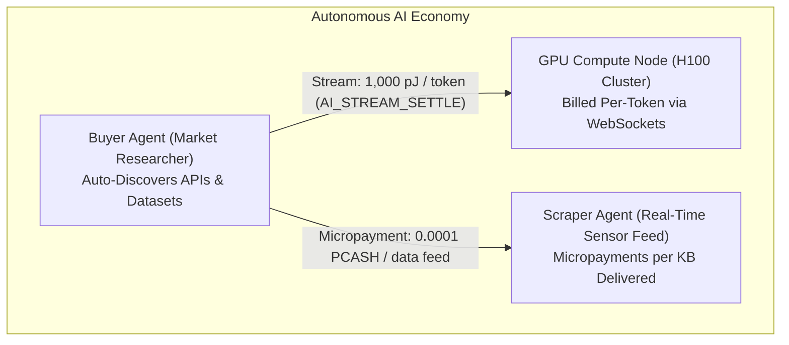
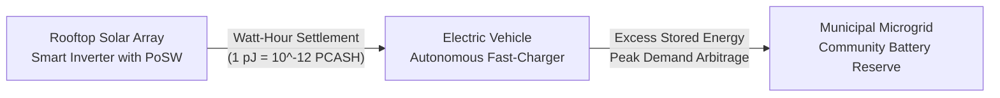

# ProofCash Ecosystem Roadmap: Future Projects, Financial Inclusion & Autonomous Banking Architecture

> **Protocol:** ProofCash (`PCASH`) — Layer-1 Autonomous Thermodynamic Settlement Engine  
> **Canonical Radicle URN:** `rad:zHqa2hHCU4ARpLvjQCDNxJdc487F`  
> **GitHub Repository:** [`https://github.com/renishidaproject/proofcash.git`](https://github.com/renishidaproject/proofcash.git)  
> **Author:** Ren Ishida (`renishida@proton.me`)  
> **Version:** 1.0 (Master Ecosystem Blueprint)  
> **License:** MIT-0 / Unlicense (Public Domain Dedication)

---

## 1. Executive Vision: A Universal Thermodynamic Substrate

Most existing blockchains were designed around the constraints of 2010s distributed systems: sequential state execution, global storage bloat, unpredictable transaction fees, and high friction onboarding that demands seed phrase memorization.

ProofCash is engineered from first principles as a **physical-layer digital settlement substrate** where energy dissipation is coupled to zero-knowledge state transitions. It combines four foundational breakthroughs:



---

## 2. Global Financial Inclusion & Sovereign Unbanked Solutions

Over **1.4 billion adults worldwide** remain unbanked according to the World Bank. The primary barriers are lack of government-issued identity documents, inability to maintain minimum account balances, geographical isolation from bank branches, and prohibitive service fees. ProofCash solves each structural hurdle at the protocol level.



### 2.1 The $30 Smartphone as an Impenetrable Private Vault
* **The Problem:** Traditional crypto requires non-technical individuals to understand private keys, write down 24-word English seed phrases (useless for illiterate or non-English populations), and risk losing their life savings if a piece of paper is stolen or damaged.
* **The ProofCash Solution:** By binding account authorization to the phone's native hardware security module (Apple Secure Enclave, Android StrongBox, TEE) via [`PasskeyCrypto`](../wallet/passkey-crypto.js), **any fingerprint or facial scan instantly authorizes transactions**. No seed phrase ever touches memory or disk. If a device is replaced, 2-of-3 Shamir social recovery allows trusted family members or community elders to reconstruct custody without any party holding the complete key.

### 2.2 Frictionless Cross-Border Remittances (0% Gouging)
* **The Problem:** Migrant workers sending money home to families in Latin America, Sub-Saharan Africa, and Southeast Asia lose an average of **6.25% to 14%** to predatory remittance middlemen (Western Union, MoneyGram, bank wire fees) with 3-to-5 day settlement delays.
* **The ProofCash Solution:** 
  - A worker in Tokyo or Chicago can transmit $50 worth of PCASH to a relative in rural Kenya or the Philippines in **under 3 seconds**.
  - The transaction fee is strictly fixed at $\ge 0.0001\text{ PCASH}$ (a fraction of a cent), saving families hundreds of dollars annually.
  - Recipient devices can receive payments **even when completely disconnected from the internet** via cryptographic eUTXO Transfer Vouchers transferred over local Bluetooth, audio frequency, or printable QR vouchers.

### 2.3 Decentralized Rotating Savings & Credit Associations (ROSCAs / Tandas / Chit Funds)
* **The Concept:** In developing economies, over 60% of small business capital is raised through informal community lending pools known as *Tandas* (Latin America), *Chit Funds* (India), *Susus* (West Africa), or *Kiye* (Korea).
* **The ProofCash Solution:**
  - Traditional ROSCAs suffer from organizer default or cash theft.
  - ProofCash's Commutative Monoid Delta Engine allows community members to commit micro-contributions to an automated, non-custodial smart pool.
  - Funds are disbursed automatically to the cycle's designated recipient through cryptographically signed zero-knowledge proofs, eliminating embezzlement and manual bookkeeping.

### 2.4 Hyperinflation & Currency Collapse Armor
* **The Problem:** Citizens in Argentina, Nigeria, Lebanon, Turkey, and Venezuela face annual inflation rates exceeding 50% to 200%, eroding purchasing power daily.
* **The ProofCash Solution:** ProofCash's emission schedule is hard-coded by the continuous exponential decay formula:
  $$R(b) = R_0 \cdot e^{-\lambda b} \quad \text{where } R_0 = 100.0\text{ PCASH}, \; \lambda = 10^{-7}$$
  Total issuance is mathematically capped at exactly $1,000,000,000\text{ PCASH}$ ($10^{21}\text{ pJ}$). No government, central bank, or protocol developer can print additional supply or inflate balances.

---

## 3. Autonomous Banking & Institutional Finance Architecture

Beyond retail inclusion, ProofCash provides the foundation for decentralized, mathematically auditable corporate treasury management and institutional settlement.



### 3.1 Real-Time Streaming Payroll & Continuous Compensation
* **Legacy Inefficiency:** Modern payroll systems operate on archaic 14-day or 30-day delayed cycles. Businesses sit on employee capital, while workers take out predatory payday loans at 400% APR to cover emergency medical or grocery bills.
* **ProofCash Streaming Architecture:**
  - ProofCash's exact $10^{-12}\text{ pJ}$ BigInt fixed-point engine allows employers to stream salary **every single second**.
  - A worker earning \$30/hour receives \$0.00833 per second directly into their biometric phone vault.
  - If a worker finishes an 8-hour shift, their balance has accumulated in real-time, ready to spend immediately on their commute home.
  - Zero float risk, zero payroll processor intermediaries (ADP, Paychex), zero payday loan exploitation.

### 3.2 Private Corporate Treasuries & Hardware-Enclave Governance
* **Legacy Vulnerability:** Corporate crypto treasuries rely on complex multi-signature smart contracts (Gnosis Safe) that suffer from gas spikes, front-running attacks, and single-point-of-failure seed phrase mismanagement.
* **ProofCash Architecture:**
  - Executive teams use **Two-Tier Hardware Delegation**: The CEO, CFO, and Chief Auditor enroll their personal hardware enclaves (MacBook TouchID, iPhone FaceID, YubiKey).
  - To authorize a \$1,000,000 spend, $M$-of-$N$ executives tap their biometric sensors.
  - Each tap signs a lightweight delegation certificate valid for a pre-determined block window (e.g., 72 blocks = ~12 hours).
  - The aggregate Zero-Knowledge AIR proof verifies client-side in under 100ms and settles immediately on-chain with zero public exposure of executive identities.

### 3.3 Zero-Knowledge Proof-of-Solvency for Exchanges and Fintechs
* **Legacy Problem:** Centralized exchanges (FTX, Celsius) collapse because customer deposits are rehypothecated or gambled away in secret.
* **ProofCash Solution:**
  - Exchanges and banks built on ProofCash can publish an hourly zero-knowledge proof generated by the GPU/Binius pipeline.
  - The proof mathematically demonstrates:
    $$\sum \text{Customer Liabilities} \le \sum \text{Cryptographic Vault Reserves}$$
  - **Zero Privacy Leak:** Individual account balances, customer names, and internal trading strategies remain completely shielded inside the Poseidon2 Merkle tree. Customers get mathematical proof of full solvency without public surveillance.

### 3.4 Interbank Settlement & Real-Time Gross Settlement (RTGS)
* **Legacy Problem:** The SWIFT network takes 2 to 5 business days for cross-border wire transfers, routing through multiple correspondent banks that each take a fee cut and introduce compliance friction.
* **ProofCash Solution:**
  - Financial institutions can utilize ProofCash as a neutral, high-speed, $O(1)$ constant-time settlement rail.
  - Multi-million dollar institutional tranches settle atomically with cryptographic finality in under 60 seconds, eliminating counterparty credit risk and pre-funding liquidity requirements (Nostro/Vostro accounts).

---

## 4. Autonomous AI & Machine-to-Machine (M2M) Agent Economy

As autonomous AI agents, LLM pipelines, and automated bots become economic actors, they require a native currency. A software program cannot open a Chase checking account, obtain a credit card, or undergo video KYC. ProofCash is the natural economic rail for machine intelligence.



### 4.1 Pay-Per-Token LLM Inference Streaming
* AI inference providers (Llama 3, DeepSeek, Mistral) currently charge users via monthly \$20 SaaS subscriptions or credit card pre-authorizations.
* **With ProofCash:**
  - Users and client applications establish an off-chain streaming channel.
  - For every token generated by the model, the client streams 1,000 pJ ($10^{-9}\text{ PCASH}$) over an encrypted WebSocket.
  - If the model produces low-quality output or hallucination, the client severs the connection immediately.
  - Settle instantly with zero API key fraud, zero credit card chargebacks, and zero monthly subscription lock-in.

### 4.2 Autonomous Agent-to-Agent Service Bounties
* An autonomous researcher agent can hire a translation agent to translate 500 Japanese documents into English, hire a code review agent to audit a Python script, and hire an edge miner to verify a mathematical proof.
* Payments execute via non-custodial eUTXO vouchers. The entire workflow occurs programmatically with zero human intervention.

### 4.3 Hardware-Attested Agent Verification (Anti-Sybil Proof of Compute)
* ProofCash allows AI agents running in confidential computing environments (Intel SGX, AMD SEV, Nvidia H100 TEE) to sign transactions using hardware-derived keys.
* This provides cryptographic proof that an AI agent is running unaltered open-weight code, establishing trust between autonomous counterparties.

---

## 5. DePIN (Decentralized Physical Infrastructure) & Thermodynamic Grids

ProofCash ties cryptographic state transitions to physical thermodynamics through Proof-of-Succinct-Work (PoSW). This makes it uniquely matched for physical infrastructure and energy networks.



### 5.1 Peer-to-Peer EV Charging & Micro-Grid Solar Settlement
* **Use Case:** A homeowner with rooftop solar produces excess energy. An electric vehicle pulls into the driveway to charge.
* **ProofCash Execution:**
  - The vehicle's onboard computer and the solar inverter establish a direct P2P mesh channel over Bluetooth or local Wi-Fi.
  - Energy is transferred in real-time, settled continuously at 1 Watt-hour = $X$ pico-Joules.
  - Zero utility company surcharge, zero payment processing terminal hardware required.

### 5.2 Decentralized Wireless (DeWi) & Sensor Meshes
* Community members deploying Wi-Fi access points or LoRaWAN gateways earn micro-settlements for every megabyte of data routed through their antenna.
* IoT environmental sensors (air quality, ocean salinity, temperature) sell real-time telemetry to climate scientists and weather forecasting models at fractions of a cent per data packet.

---

## 6. Consumer Micro-Commerce & Web3 Media Platforms

### 6.1 Unbundled Pay-Per-Article & Pay-Per-Second Media
* **Current Dilemma:** News publications (Wall Street Journal, New York Times) force users into \$30/month subscriptions when users only want to read a single article. Users bounce, and publishers suffer ad-blocker revenue collapse.
* **ProofCash Solution:**
  - A browser extension or native browser with WebAuthn Passkeys prompts: *"Read this investigative report for 0.005 PCASH (\$0.01)?"*
  - A single TouchID or FaceID tap authorizes the spend in 45 milliseconds.
  - Media companies receive 100% of the funds instantly with zero payment processor fees.

### 6.2 Seedless In-Game Micro-Economies
* Mobile games can integrate sovereign micro-wallets directly into gameplay.
* Players earn fractions of PCASH for discovering rare items, winning tournaments, or providing in-game guild services.
* Items are stored in sovereign eUTXO vaults that persist across games and platforms.

---

## 7. Developer Integration Blueprint & Architecture Stack

Developers building applications on ProofCash utilize three standardized layers:

```
+-----------------------------------------------------------------------------------------+
|                              PROOFCASH DEVELOPER STACK                                  |
+-----------------------------------------------------------------------------------------+

  LAYER 3: APPLICATION & UI LAYER
  * WebAuthn PWA SDK: Sovereign biometric passkey enrollment & transaction signing
  * Mobile Flutter / React Native Bridges: Native iOS Secure Enclave & Android StrongBox
  * REST / GraphQL Indexer APIs: Real-time transaction feeds & address balance indexing
  
  LAYER 2: P2P MESH & STREAMING RELAYS
  * Cloudflare Edge Mesh (WebSocket / HTTP): Global sub-second peer gossip
  * Cryptographic Transfer Vouchers: 100% offline device-to-device settlement
  * Commutative Monoid Batcher: Non-blocking parallel UTXO delta consolidation
  
  LAYER 1: SOVEREIGN PROTOCOL & CONSENSUS
  * proofcashd JSON-RPC 2.0 Gateway: Full node validation & MMR state verification
  * Two-Tier AIR Prover: 1,842 in-circuit constraints (<45ms client-side spend proofs)
  * Blake3 PoSW Consensus Engine: Continuous thermodynamic emission & PID fee reservoir
+-----------------------------------------------------------------------------------------+
```

### Turnkey Developer Resources
* **Production Gateway:** `https://rpc.proofcash.org`
* **Edge Mesh Relay:** `wss://relay.proofcash.org/ws`
* **PWA & Explorer Portal:** `https://proofcash.org`
* **Full Node Turnkey Installer:** `scripts/setup_node.sh`
* **Master Runbook:** `docs/MAINNET_RUNBOOK.md`

---

## 8. Summary & Strategic Trajectory

ProofCash transforms digital currency from a speculative trading asset into a **frictionless physical-layer thermodynamic utility**. 

By eliminating seed phrases in favor of biometric hardware enclaves, replacing floating-point rounding errors with exact pico-Joule BigInt arithmetic, and removing UTXO contention through commutative monoids, ProofCash provides the foundation for:
1. **Human Dignity:** Universal financial access for the world's 1.4 billion unbanked.
2. **Economic Efficiency:** Streaming micro-compensation and autonomous corporate treasuries.
3. **Machine Independence:** High-frequency, sub-cent settlement rails for autonomous AI agents and thermodynamic energy grids.
