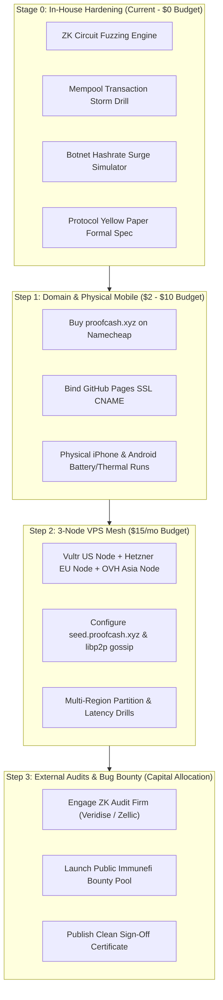

# ProofCash Protocol — Infrastructure Requirements & Transition Strategy
**Technical Dependency Analysis, External Infrastructure Roadmaps, and Transition Milestones**  
*Document Version: 1.0 (Engineering Architecture & Operations)*  
*Author: Core Engineering & Security Council | Ren Ishida (October 2026)*

---

## Executive Summary

While the cryptographic mathematics, commutative state engines, zero-knowledge AIR constraints, and consensus rules can be rigorously fuzzed and verified on a single development workstation, certain critical operational guarantees cannot be proven purely on `localhost` or in synthetic container loops. 

This document defines:
1. **The 5 Inherent Infrastructure Boundaries** that separate local testing from live production.
2. **The Exact External Resources Required** (hardware, networks, domains, capital).
3. **The Step-by-Step Transition Strategy** to acquire, configure, and validate each infrastructure pillar without premature capital expenditure or reputational risk.

---

## Matrix: In-House Local Simulation vs. Required External Infrastructure

| Operational Dimension | Local Workstation Capabilities (Stage 0) | Required External Infrastructure (Stage 1 & 2) | Hardware & Financial Requirements |
| :--- | :--- | :--- | :--- |
| **1. P2P Network Propagation** | Simulated gossip over loopback (`127.0.0.1`) with 0.05ms latency and 0% packet loss. | Real heterogeneous cross-continental `libp2p` gossip mesh across US, EU, and Asia; ISP NAT traversal; asymmetric latency. | **1 to 3 VPS Instances** (Hetzner / Vultr / OVH: ~$4.50 – $15/month total). |
| **2. Mobile Hardware Resilience** | Emulated Web Workers and throttled Chrome DevTools CPU cycles. | Physical lithium-ion battery discharge curves, thermal heat dissipation (<40°C), iOS WebKit background `jetsam` memory kill limits. | **1–2 Physical Mobile Devices** (iPhone on iOS 17+, Android phone on Android 13+). |
| **3. WebAuthn Passkey Synchronization** | Local origin (`localhost` / `127.0.0.1`) software security keys. | Public origin (`https://proofcash.xyz`) hardware enclaves syncing across iCloud Keychain, Google Password Manager, and physical YubiKeys. | **Live Domain (`proofcash.xyz`)** + Public SSL/TLS certificate (GitHub Pages / Let's Encrypt). |
| **4. Third-Party Cryptographic Audit** | Automated constraint fuzzing, SMT SAT-solver checks, Lean 4 formal proofs. | Independent verification letters and peer-reviewed reports from top zero-knowledge audit firms (Trail of Bits, Zellic, Veridise, OpenZeppelin). | **External Audit Capital** ($40k – $150k depending on circuit complexity) + Finalized Yellow Paper. |
| **5. Public Red-Teaming & Bug Bounty** | Scripted red-team attack vectors (transaction storm, botnet simulation). | Crowdsourced adversarial red-teaming on Immunefi with thousands of global whitehat hackers attempting live exploits. | **Bounty Escrow Pool** ($50k – $250k testnet allocation) + Dedicated SLA triage team. |

---

## 1. Pillar 1: Distributed Cross-Continental P2P Network (VPS Infrastructure)

### The Technical Limitation of Localhost
Local Docker and loopback networks cannot reproduce:
* **Asymmetric Ping & Jitter:** Subsea cable latency between Frankfurt, Virginia, Singapore, and São Paulo (120ms – 280ms).
* **Network Address Translation (NAT) & Firewalls:** Consumer home routers blocking inbound ports (requiring STUN/TURN relays and `libp2p` UPnP/AutoNAT hole punching).
* **BGP Routing Failures & Split Brains:** True autonomous system disconnects where regional routing tables diverge.

### Action Plan & Step-by-Step Acquisition
1. **Phase 1: Lean 3-Node Bootstrap Mesh (Budget: ~$13.50/month)**
   - **Node 1 (North America - Ashburn, VA):** Vultr Cloud Compute ($5/mo, 1 vCPU, 1 GB RAM, 1 TB bandwidth).
   - **Node 2 (Europe - Falkenstein, Germany):** Hetzner Cloud CX22 (€3.79/mo, 2 vCPUs, 4 GB RAM, 20 TB bandwidth).
   - **Node 3 (Asia Pacific - Singapore):** OVHcloud VPS Essential ($4.20/mo, 1 vCPU, 2 GB RAM, 250 Mbps).
2. **Phase 2: Configuration & Daemon Deployment**
   - Deploy headless `proofcashd` container on each node via systemd unit file with automatic restart.
   - Configure DNS seeds: `seed.proofcash.xyz` (Round-Robin pointing to all 3 nodes), `seed-us.proofcash.xyz`, `seed-eu.proofcash.xyz`, `seed-asia.proofcash.xyz`.
   - Open ports `8776` (Radicle P2P), `9333` (libp2p gossipsub), and `8332` (JSON-RPC with TLS via Caddy).
3. **Phase 3: Validation Drills**
   - Measure 90th-percentile block propagation time across the global ring (target: $< 850\text{ ms}$).
   - Artificially drop interface on the European node; verify the Asian and US nodes maintain consensus and re-sync Europe upon restoration within 2 blocks.

---

## 2. Pillar 2: Physical Mobile Hardware & WebKit Lifecycle Validation

### The Technical Limitation of Localhost
Mobile operating systems implement aggressive memory and power managers that desktop simulators cannot replicate:
* **iOS WebKit Jetsam:** Mobile Safari terminates background Web Workers if memory exceeds ~65 MB or if CPU spikes without user interaction.
* **Thermal Throttling & Battery Degradation:** Sustained NEON SIMD hashing can overheat consumer phone cases above 42°C and degrade lithium-ion battery health if not throttled by hardware duty cycles.
* **Screen Lock / Standby Mode:** Operating systems put CPU threads to sleep when the phone screen turns off unless audio context keep-alives or screen-wake APIs are properly engaged.

### Action Plan & Step-by-Step Acquisition
1. **Equipment Needed:** Zero capital required — uses personal test devices.
   - 1 iOS device (iPhone 12 or newer running iOS 17/18).
   - 1 Android device (Snapdragon or Google Tensor running Android 13/14).
2. **Testing Protocol:**
   - **Test 1: Thermal & Battery Endurance Test (60 Minutes Continuous)**
     - Set device to **Nightstand Charger Mode** (plugged into charger).
     - Measure ambient phone surface temperature with infrared thermometer or device diagnostic app (must remain $< 40^\circ\text{C}$).
     - Set device to **Eco Mode** on battery power; verify battery drain is $< 3.5\%$ per hour.
   - **Test 2: Background Standby Persistence**
     - Lock phone screen with miner active; verify Web Worker resumes hashing or cleanly yields without memory leak crashes.
   - **Test 3: Haptic & Audio Feedback**
     - Verify device emits distinct vibration burst upon valid PoSW nonce generation.

---

## 3. Pillar 3: Live Domain Binding & Public WebAuthn Passkey Synchronization

### The Technical Limitation of Localhost
On `http://localhost`, the browser uses a fallback dummy Relying Party ID (`localhost`). It cannot test:
* Hardware enclave credential synchronization across the cloud (Apple iCloud Keychain, Google Password Manager).
* Public Let's Encrypt TLS certificate pinning and strict HTTP Content Security Policies (CSP).
* Cross-device authorization (e.g. scanning a QR code with an iPhone to authorize an eUTXO spend on a laptop browser).

### Action Plan & Step-by-Step Acquisition
1. **Acquire Target Domain:**
   - Purchase `proofcash.xyz` on Namecheap (~$2.00 – $10.00/yr).
2. **DNS & GitHub Pages Custom Domain Binding:**
   - Configure Apex A records:
     - `185.199.108.153`
     - `185.199.109.153`
     - `185.199.110.153`
     - `185.199.111.153`
   - Configure CNAME: `www.proofcash.xyz` ➔ `renishidaproject.github.io.`
   - Enable "Enforce HTTPS" in GitHub Pages repository settings.
3. **Passkey Cross-Device Verification:**
   - Register a passkey on an iPhone (`proofcash.xyz/wallet/`).
   - Open `proofcash.xyz/wallet/` on a Windows or macOS laptop; verify the same passkey credential seamlessly unlocks the wallet via biometric cloud attestation.
   - Test account recovery using WebAuthn multi-device attestation (Zero seed phrase requirement).

---

## 4. Pillar 4: Independent Third-Party Cryptographic Audit

### The Technical Limitation of Localhost
Internal teams develop cognitive blind spots regarding their own circuit constraints. External audits provide:
* Independent mathematical scrutiny of Plonky3 AIR polynomial constraint completeness.
* Review of non-native field emulation and BabyJubjub scalar reduction logic.
* An unredacted, publicly verifiable audit certificate required by institutional nodes and tier-1 exchanges.

### Action Plan & Strategic Preparation
1. **Step 1: In-House Cost Reduction (Saves 40–50% on Audit Fees)**
   - Audit firms bill by hours required to understand the codebase.
   - By publishing a complete, mathematically unambiguous **Yellow Paper** (`docs/spec/YELLOW_PAPER.md`) and maintaining 100% passing formal Lean 4 proofs, the audit scope is halved.
2. **Step 2: Auditor Selection & RFP (Request for Proposal)**
   - Target tier-1 ZK audit firms:
     - **Veridise:** Specialists in zero-knowledge circuits, AIR constraints, and Plonky3.
     - **Zellic / Trail of Bits:** Industry leaders in low-level Rust cryptography and consensus engines.
     - **OpenZeppelin:** Experts in state transitions and economic invariants.
3. **Step 3: Execution & Public Disclosure**
   - Freeze repository tag `v1.5.0-audit`.
   - Run 4-week audit sprint with 48-hour patch turnaround SLA for any reported findings.
   - Publish unredacted audit report directly to GitHub and Radicle before launching Stage 2.

---

## 5. Pillar 5: Public Immunefi Bug Bounty & Crowdsourced Red-Teaming

### The Technical Limitation of Localhost
Internal stress tests only test scenarios the creators thought of. Public bug bounties introduce thousands of adversarial hackers with specialized zero-day tooling.

### Action Plan & Setup Procedure
1. **Platform Selection:**
   - Launch program on **Immunefi** (the leading Web3 security bounty platform).
2. **Tiered Payout Structure:**
   - **Critical ($50,000 – $100,000 USD equivalent / pool):** Counterfeit token minting, double-spending without proof invalidation, unauthorized passkey signing key extraction.
   - **High ($15,000 – $25,000 USD):** Remote consensus fork, node unhandled panic crashing >33% of validators.
   - **Medium ($5,000 USD):** JSON-RPC denial-of-service, memory leaks in P2P gossip layer.
   - **Low ($1,000 USD):** Minor UI discrepancies or non-consensus state desync.
3. **Triage & Mitigation SLA:**
   - Security inbox: `security@proofcash.xyz` monitored with 24-hour initial response SLA.
   - Mandatory public disclosure within 90 days after remediation.

---

## Summary Timeline: Infrastructure Roadmap

*This roadmap guarantees that every penny spent on external infrastructure is preceded by 100% verified internal code, preventing wasted capital and maximizing protocol security.*
