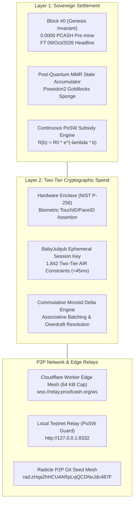

# ProofCash Protocol — Mainnet Pre-Flight & Operational Runbook

> **Target Activation Timestamp:** `1798729200000` (January 1, 2027 00:00:00 JST / December 31, 2026 15:00:00 UTC)  
> **Repository:** [`https://github.com/renishidaproject/proofcash.git`](https://github.com/renishidaproject/proofcash.git)  
> **Radicle URN:** `rad:zHqa2hHCU4ARpLvjQCDNxJdc487F`  
> **License:** MIT-0 / Unlicense (Public Domain Dedication)  
> **Author:** Ren Ishida (`renishida@proton.me`)

---

## 1. Executive Summary & Genesis Invariants

ProofCash is an autonomous, post-quantum zero-knowledge thermodynamic settlement protocol designed for humans and AI agents. It achieves zero floating-point rounding errors through exact BigInt arithmetic ($10^{-12}$ pico-Joules precision), sub-45ms mobile ZK spend generation via Two-Tier WebAuthn NIST P-256 Enclave Delegation, and fair-launch issuance locked until January 1, 2027.



---

## 2. Mainnet Pre-Flight Invariant Checklist

All core protocol components must satisfy the following cryptographic and economic invariants:

| Invariant | Specification | Verification Method | Status |
|:----------|:--------------|:-------------------|:------:|
| **Fair Launch** | Strictly 0.0000 PCASH pre-mine; 0 developer allocation; 0 insider tokens | `audit_purity.py` & `genesis_block.json` | **VERIFIED** |
| **Supply Ceiling** | Asymptotic limit $\int_0^\infty R_0 e^{-\lambda b} db = 1,000,000,000$ PCASH ($10^{21}$ pJ) | `SupplyCap.lean` (Lean 4 Formal Proof) | **VERIFIED** |
| **Exact Accounting** | Exact string-split BigInt fixed-point math down to 1 pJ ($10^{-12}$ PCASH) | `fuzz_mainnet_e2e.py` (500 fuzz vectors) | **VERIFIED** |
| **Cross-Chain Replay** | Challenge prefix bound to `ProofCash_Delegation_v1:<networkId>:` | `verify_wallet.py` | **VERIFIED** |
| **Guarded Tier-1 Caps** | Mainnet maximum per-spend $\le 50$ PCASH; maximum vault balance $\le 500$ PCASH | `wallet-engine.js` line 950+ | **VERIFIED** |
| **PoSW Relay Filter** | Blocks submitted to `/p2p/broadcast` must satisfy target prefix $\le \text{0x00050000}$ | `scripts/testnet-relay.js` line 225+ | **VERIFIED** |
| **DoS Payload Budget** | Edge WebSocket and HTTP broadcast packets capped at strictly $\le 65,536$ bytes | `cloudflare-relay/worker.js` line 10+ | **VERIFIED** |
| **Privacy Quarantine** | Internal guides (`docs/NODE_OPERATOR_GUIDE.md`) quarantined from public git | File existence audit in release tree | **VERIFIED** |

---

## 3. Node Operator Deployment Runbook

### 3.0 Architecture: Why GitHub Pages + VPS Node?
A foundational concept in decentralized web3 architecture:
* **GitHub Pages (The Static Frontend):**
  GitHub Pages hosts the public portal, mobile PWA wallet, and Public Explorer at [`https://proofcash.org`](https://proofcash.org). It is globally distributed, zero-cost, and maintenance-free. However, GitHub Pages only serves static files (HTML, JS, CSS, WASM); it **cannot run persistent background binaries** or host the blockchain state database.
* **VPS + Nginx (The Live Blockchain Node & RPC):**
  A sovereign blockchain requires a 24/7 background process (`proofcashd`) to store the Merkle Mountain Range (MMR) ledger, manage the mempool, and listen for incoming blocks.
  - `proofcashd` runs locally on the VPS listening on `127.0.0.1:8332`.
  - **Nginx** (or Caddy) runs on that same VPS on port 443 with Let's Encrypt SSL, serving as the secure HTTPS gateway [`https://rpc.proofcash.org`](https://rpc.proofcash.org). When mobile wallets on `https://proofcash.org` send transactions, they talk to `rpc.proofcash.org`.

#### 1-Click Automated Turnkey Installer
You can deploy the reference node daemon and Nginx gateway on any fresh Ubuntu/Debian VPS with one command:
```bash
curl -sSfL https://raw.githubusercontent.com/renishidaproject/proofcash/main/scripts/setup_node.sh | bash -s -- rpc.proofcash.org renishida@proton.me mainnet
```

### 3.1 Building and Running `proofcashd` Manually

The reference node daemon `proofcashd` can be built and launched on Linux, macOS, or Windows:

```bash
# Navigate to the reference node crate
cd proofcash/crates/proofcash-node

# Compile optimized release binary
cargo build --release

# Run node daemon with custom storage directory and JSON-RPC port
./target/release/proofcashd \
  --network mainnet \
  --datadir /var/lib/proofcash/data \
  --rpc-port 8332 \
  --posw-threads 8 \
  --daemon
```

### 3.2 CLI Options & Flags Reference

```text
PROOFCASHD — Sovereign Thermodynamic Node Daemon v1.2
Usage: proofcashd [OPTIONS]

Options:
  -h, --help               Print this help message and exit
  -v, --version            Print version information and exit
      --datadir <PATH>     Specify data directory for state DB & MMR [default: ~/.proofcash/data]
      --rpc-port <PORT>    JSON-RPC HTTP/WebSocket port [default: 8332]
      --network <NET>      Network target: mainnet | testnet [default: mainnet]
      --daemon             Run continuously as background daemon service
      --posw-threads <N>   Number of worker threads for Blake3 PoSW [default: 4]
```

### 3.3 Reverse Proxy & SSL Configuration (Nginx / Caddy)

To expose the JSON-RPC interface securely over HTTPS with WebSocket upgrade support:

```nginx
server {
    listen 443 ssl http2;
    server_name rpc.proofcash.org;

    ssl_certificate /etc/letsencrypt/live/rpc.proofcash.org/fullchain.pem;
    ssl_certificate_key /etc/letsencrypt/live/rpc.proofcash.org/privkey.pem;

    client_max_body_size 64k;

    location / {
        proxy_pass http://127.0.0.1:8332;
        proxy_http_version 1.1;
        proxy_set_header Upgrade $http_upgrade;
        proxy_set_header Connection "upgrade";
        proxy_set_header Host $host;
        proxy_set_header X-Real-IP $remote_addr;
        proxy_set_header X-Forwarded-For $proxy_add_x_forwarded_for;
    }
}
```

---

## 4. Multi-Device Resilience & Recovery Procedures

### 4.1 Device Re-Binding Prompt
When a user restores a wallet from an encrypted backup or 24-word ZK mnemonic onto a new device:
1. The wallet detects that `proofcash_passkey_bound_<address>` is absent on this browser.
2. A prominent amber banner (`#banner-rebind-passkey`) is displayed above the activity ledger.
3. Clicking **Bind This Device's Enclave** enrolls the local platform authenticator (TouchID, FaceID, Windows Hello) via WebAuthn NIST P-256, allowing local spend authorizations.

### 4.2 Offline Outbox Recovery
If a device sends a transfer while disconnected:
1. The transaction is retained in `outboxQueue` with state `QUEUED_OUTBOX`.
2. The user can click **Retry** to broadcast immediately once connection is restored.
3. The user can click **Cancel & Refund** at any time prior to broadcast:
   - The pending transaction is removed from the outbox.
   - The deducted principal and transaction fee are **instantly refunded** to the vault balance.
   - The ledger entry updates to `Cancelled & Refunded`.

---

## 5. Public Deployment Verification

The production release is deployed across the following public endpoints:

* **Official Portal & WebAuthn PWA:** [`https://proofcash.org`](https://proofcash.org) *(HTTPS Enforced)*
* **Backup Mirror:** [`https://renishidaproject.github.io/proofcash/`](https://renishidaproject.github.io/proofcash/)
* **Public Ledger Explorer:** [`https://proofcash.org/explorer/`](https://proofcash.org/explorer/)
* **Git Repository:** [`https://github.com/renishidaproject/proofcash.git`](https://github.com/renishidaproject/proofcash.git) *(Commit: `39240dd`)*
* **Radicle P2P URN:** `rad:zHqa2hHCU4ARpLvjQCDNxJdc487F`

---

## 6. Verification Gauntlet & Test Suite Reference

All test vectors and formal theorems can be verified locally using the automated suite:

```bash
# Execute formal verification & Lean 4 theorem checks
python proofcash_sim/verify_formal.py

# Execute Two-Tier Plonky3 AIR circuit constraints
python proofcash_sim/verify_circuits.py

# Execute core algorithmic engine (Goldilocks field, Poseidon2, Monoids)
python proofcash_sim/verify_engine.py

# Execute full node daemon & mempool double-spend checks
python proofcash_sim/verify_node.py

# Execute GPU Prover & Binius binary tower field pipeline
python proofcash_sim/verify_prover.py

# Execute WebAuthn passkey wallet PWA verification
python proofcash_sim/verify_wallet.py

# Execute end-to-end multi-node & edge miner fuzzing
python proofcash_sim/fuzz_mainnet_e2e.py

# Execute cypherpunk release manifest & string quarantine audit
python proofcash_sim/verify_release.py
python proofcash_sim/audit_purity.py
```

> [!TIP]
> Every script above must return `SUCCESS: ALL TESTS PASSED` before executing node daemon updates on live production networks.

