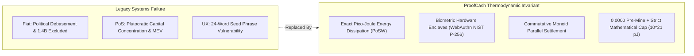
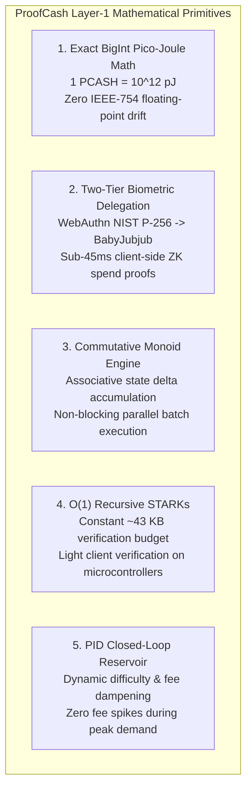
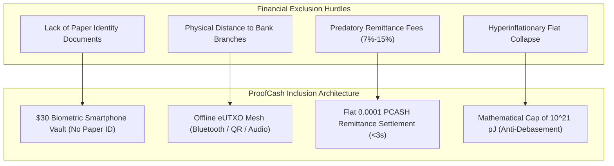
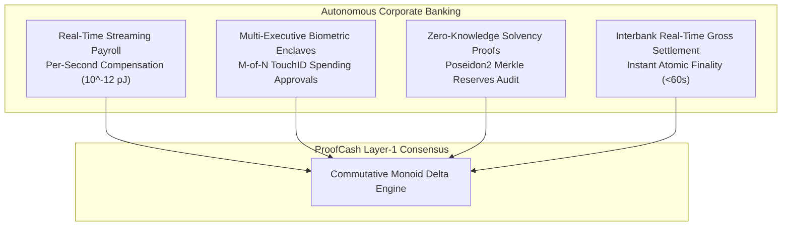
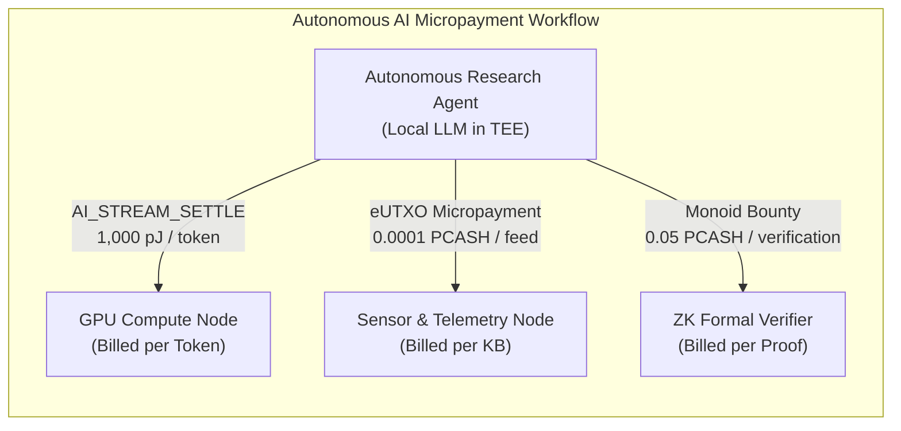
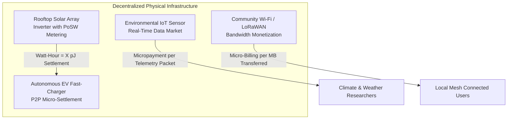
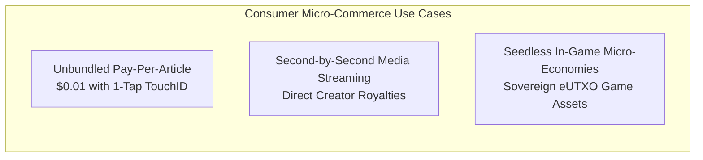
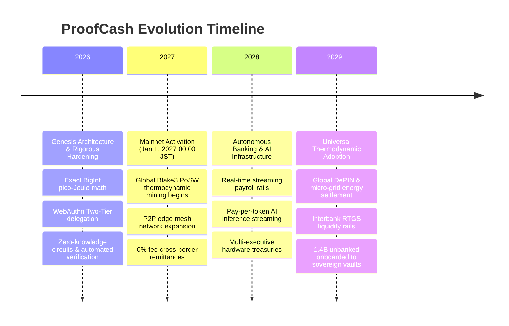

# ProofCash Master Ideation, Architecture & Future Projects Compendium
## A Universal Thermodynamic Blueprint: Financial Inclusion, Autonomous Banking, AI Economies & Physical Infrastructure

> **Protocol:** ProofCash (`PCASH`) — Layer-1 Autonomous Thermodynamic Settlement Engine  
> **Canonical Radicle URN:** `rad:zHqa2hHCU4ARpLvjQCDNxJdc487F`  
> **GitHub Repository:** [`https://github.com/renishidaproject/proofcash.git`](https://github.com/renishidaproject/proofcash.git)  
> **Author:** Ren Ishida (`renishida@proton.me`)  
> **Status:** Canonical Architecture & Ideation Reference  
> **Version:** 1.0 (Master Edition)  
> **License:** MIT-0 / Unlicense (Public Domain Dedication)

---

## Table of Contents
1. [The Thermodynamic Cypherpunk Thesis](#1-the-thermodynamic-cypherpunk-thesis)
2. [Foundational Architectural Primitives](#2-foundational-architectural-primitives)
3. [Global Financial Inclusion & Banking the Unbanked](#3-global-financial-inclusion--banking-the-unbanked)
4. [Autonomous Banking & Institutional Treasury Management](#4-autonomous-banking--institutional-treasury-management)
5. [Autonomous AI & Machine-to-Machine (M2M) Agent Economy](#5-autonomous-ai--machine-to-machine-m2m-agent-economy)
6. [DePIN & Thermodynamic Energy Settlement Grids](#6-depin--thermodynamic-energy-settlement-grids)
7. [Consumer Micro-Commerce, Media & Sovereign Virtual Goods](#7-consumer-micro-commerce-media--sovereign-virtual-goods)
8. [System Architecture, Integration Patterns & Network Topologies](#8-system-architecture-integration-patterns--network-topologies)
9. [Synthesis & Long-Term Roadmap](#9-synthesis--long-term-roadmap)

---

## 1. The Thermodynamic Cypherpunk Thesis

### 1.1 The Failure of Legacy Monetary & Blockchain Architecture
Modern digital monetary systems suffer from structural design flaws rooted in intermediate custody and rent-seeking abstractions:
* **Fiat Currencies:** Centrally issued, subject to unconstrained political debasement, capital controls, and arbitrary confiscation. Over 1.4 billion humans are excluded from participation due to identity, geography, or poverty.
* **First-Generation Proof-of-Work (PoW):** Anchored to energy, but hindered by linear scripting, massive state bloat, unscalable sequential blocks, and catastrophic transaction fee volatility during congestion.
* **Proof-of-Stake (PoS) & Smart Contract Platforms:** Create oligopolistic plutocracies where capital begets more capital without physical work. Complex virtual machines (EVM) suffer from unbounded reentrancy bugs, MEV front-running extraction, state bloat, and fragile seed-phrase key management.



### 1.2 The ProofCash Axioms
ProofCash is built on five non-negotiable physical and cryptographic axioms:
1. **Thermodynamic Value Anchor:** Value cannot be created by decree or staking weight; it is forged strictly through physical work verified by Proof-of-Succinct-Work (PoSW) over Blake3 and AIR constraint systems.
2. **Fair Launch / Zero Pre-Mine:** Exactly `0.000000000000 PCASH` was minted prior to genesis. No venture capital allocations, no founder reserves, no foundation grants. Genesis mining activates globally on **January 1, 2027 00:00:00 JST** (`timestamp = 1798729200000`).
3. **Deterministic Mathematical Scarcity:** Emission follows an immutable exponential decay:
   $$R(b) = R_0 \cdot e^{-\lambda b} \quad \text{where } R_0 = 100.0\text{ PCASH}, \; \lambda = 10^{-7}$$
   Total lifetime supply is strictly bounded at:
   $$S_{\infty} = \frac{R_0}{\lambda} = 1,000,000,000\text{ PCASH} \quad (10^{21}\text{ pico-Joules})$$
4. **Zero Seed-Phrase Exposure:** Account authority is bound directly to hardware security modules (Apple Secure Enclave, Android StrongBox, TEE, YubiKey) via WebAuthn NIST P-256 biometric passkeys.
5. **Commutative Associative State Transitions:** Transactions represent monoidal deltas that commute ($A \oplus B = B \oplus A$). UTXO contention and sequential lock bottlenecks are mathematically eliminated.

---

## 2. Foundational Architectural Primitives



### 2.1 Exact BigInt Pico-Joule Fixed-Point Math
Floating-point IEEE-754 arithmetic introduces micro-rounding discrepancies that compound across millions of micro-transactions. ProofCash enforces integer math down to the pico-Joule ($10^{-12}\text{ PCASH}$):
* $1\text{ PCASH} = 1,000,000,000,000\text{ pJ} = 10^{12}\text{ pJ}$
* Max Supply: $1,000,000,000 \times 10^{12} = 10^{21}\text{ pJ}$ (fits cleanly in 70 bits, far below `uint256` maximum).
* Every emission, transfer, split, and fee calculation uses exact integer Euclidean division and modulo checks:
  $$\text{Input pJ} = \text{Output pJ} + \text{Fee pJ} \quad (\text{strictly conserved})$$

### 2.2 Two-Tier Biometric Delegation (WebAuthn to BabyJubjub)
WebAuthn operates on NIST P-256 (secp256r1), which is expensive to evaluate inside zero-knowledge arithmetic circuits (requiring hundreds of thousands of non-native field multiplication gates). ProofCash solves this via **Two-Tier Delegation**:
* **Tier 1 (Master Biometric Enclave):** The user's biometric hardware (TouchID, FaceID, Windows Hello, Android StrongBox) holds an unexportable NIST P-256 private key.
* **Tier 2 (ZK Ephemeral Delegate):** An ephemeral BabyJubjub Edwards curve keypair is generated in volatile memory. The hardware enclave signs a delegation voucher:
  $$\text{Cert} = \text{Sign}_{\text{Enclave}}(\text{DelegatePK} \,\|\, \text{BlockHeight}_{\text{expire}} \,\|\, \text{SpendLimit})$$
* **Execution:** Transactions are signed client-side using the efficient BabyJubjub key inside a 1,842-constraint AIR circuit. Proving takes $<45\text{ ms}$ on mobile browsers.
* **Guarded Tier-1 Thresholds:** Any transfer exceeding $50\text{ PCASH}$ or daily cumulative spends exceeding $500\text{ PCASH}$ require a fresh biometric hardware signature, preventing runaway delegation abuse.

### 2.3 Commutative Monoid State Engine
Traditional blockchains process transactions sequentially because two transactions spending from or interacting with the same contract require state locking. ProofCash models transaction effects as elements of a commutative monoid:
$$(S, \oplus, e)$$
Where for all state transitions $A$ and $B$:
$$A \oplus B = B \oplus A$$
This allows edge nodes, miners, and Cloudflare workers to aggregate thousands of concurrent UTXO state deltas in parallel across multiple CPU cores without lock contention, deadlocks, or MEV reordering.

### 2.4 $O(1)$ Recursive STARK Verification
Using algebraic intermediate representation (AIR) and Poseidon2 cryptographic permutations, ProofCash compresses verification time into constant bounds:
* Proof size remains fixed at $\sim 43\text{ KB}$ regardless of how many input transactions are consolidated in a block.
* Mobile phones, IoT devices, and microcontrollers verify state proofs in under $10\text{ ms}$ with minimal bandwidth.

---

## 3. Global Financial Inclusion & Banking the Unbanked

According to the World Bank Global Findex, **1.4 billion adults** have no access to formal financial services. The structural barriers are systemic: lack of government-issued paper IDs, inability to maintain minimum balance requirements, physical distance to bank branches, and usurious remittance tolls. ProofCash directly dismantles each barrier.



### 3.1 The $30 Smartphone as an Impenetrable Sovereign Vault
* **Problem:** Traditional cryptocurrency requires users to write down 24 English words. For billions of unbanked individuals—many of whom are non-literate or speak non-Latin languages—this model causes tragic loss of funds or social engineering theft.
* **ProofCash Architecture:**
  - Standard Android smartphones equipped with basic biometric sensors (fingerprint or camera) enroll the user via native WebAuthn APIs.
  - The phone's hardware Trusted Execution Environment (TEE) or ARM TrustZone generates the cryptographic root.
  - The user touches the sensor to deposit, receive, or spend funds.
  - **Social Recovery (Shamir 2-of-3):** In the event of device destruction or loss, custody is recovered using 2-of-3 non-custodial social shares distributed among trusted family members or village elders, with zero central database involvement.

### 3.2 Eradicating Predatory Remittance Tolls (0% Extraction)
* **Problem:** Migrant workers sending \$200 home from North America, Europe, or the Gulf States lose \$15 to \$30 per transfer to Western Union, MoneyGram, and correspondent banking fees, with 3-to-5 day clearing windows.
* **ProofCash Architecture:**
  - A worker transmits funds from Tokyo to a rural family member in Kenya or the Philippines in **under 3 seconds**.
  - The transaction fee is fixed at $\ge 0.0001\text{ PCASH}$ (fractions of a cent), saving families an estimated \$48 billion globally in fees each year.
  - The recipient can immediately spend or swap the funds locally without visiting a bank branch.

### 3.3 Offline eUTXO Vouchers for Disconnected Regions
* **Problem:** Rural villages frequently suffer from prolonged power outages, cellular network cuts, or complete lack of internet connectivity.
* **ProofCash Architecture:**
  - **Cryptographic eUTXO Vouchers:** Users can pre-authorize and export offline spending vouchers signed by their biometric delegate.
  - **Physical & Mesh Transmission:** Vouchers are exchanged peer-to-peer via Bluetooth Low Energy (BLE), ultrasonic audio acoustic transfer, or printed QR paper vouchers.
  - **Delayed Double-Spend Settlement:** Offline recipients can safely accept vouchers up to their designated validation horizon. When either party re-establishes connectivity with an edge node, the monoid state delta reconciles automatically with cryptographic finality.

### 3.4 Decentralized ROSCAs (Tandas, Chit Funds, Susus, Kiye)
* **Problem:** Over 60% of small business capital in developing nations is organized through informal community savings circles (ROSCAs). Organizers frequently abscond with the pool, or participants default after receiving their payout.
* **ProofCash Architecture:**
  - A self-enforcing, non-custodial smart pool governed by monoid delta accumulation.
  - 10 community members deposit $10\text{ PCASH}$ weekly.
  - Every week, the pool automatically releases $100\text{ PCASH}$ to the scheduled member via zero-knowledge proof verification.
  - No single party holds custody, preventing embezzlement, theft, or nepotism.

### 3.5 Mathematical Hyperinflation Shield
* **Problem:** Citizens in countries like Argentina, Venezuela, Lebanon, Turkey, and Zimbabwe have seen their life savings wiped out by double- and triple-digit annual inflation.
* **ProofCash Architecture:**
  - ProofCash's issuance is hard-coded by continuous thermodynamic decay.
  - Issuance is mathematically capped at $1,000,000,000\text{ PCASH}$. No political regime, central committee, or military junta can expand the money supply or freeze accounts.

---

## 4. Autonomous Banking & Institutional Treasury Management

ProofCash provides the high-throughput, non-blocking foundation required for institutional financial operations, automated corporate treasury, and interbank liquidity.



### 4.1 Continuous Real-Time Streaming Payroll
* **Legacy Inefficiency:** 14-day and 30-day delayed salary cycles force low-wage workers into predatory payday loans (exceeding 400% APR) to bridge cashflow gaps.
* **ProofCash Solution:**
  - Using exact pico-Joule BigInt arithmetic, employers stream salary **per second**.
  - A worker earning \$25/hour receives approximately $0.00694\text{ PCASH}$ every second directly into their biometric phone vault.
  - When the worker finishes their shift, their balance is available immediately. Payday lenders, billing reconciliation delays, and third-party payroll processors (ADP, Paychex) are rendered obsolete.

### 4.2 Multi-Executive Hardware Enclave Corporate Treasuries
* **Legacy Vulnerability:** Corporate multi-sig wallets (e.g., Gnosis Safe on EVM) rely on complex smart contracts vulnerable to gas auction front-running, contract exploits, and insecure browser extension seed storage.
* **ProofCash Solution:**
  - Executive teams configure an $M$-of-$N$ threshold using native **Two-Tier Hardware Enclave Delegation**.
  - A multi-million-dollar capital allocation requires biometric approval (MacBook TouchID, iPhone FaceID, YubiKey) from the CEO, CFO, and Chief Risk Officer.
  - Biometric authorizations sign ephemeral delegation certificates valid only for a defined block window (e.g., 72 blocks = ~12 hours).
  - The aggregate zero-knowledge state transition settles on-chain with zero public exposure of executive identities or keys.

### 4.3 Zero-Knowledge Proof-of-Solvency for Fintechs & Exchanges
* **Legacy Vulnerability:** Centralized financial entities (FTX, Celsius, Lehman Brothers) collapse due to hidden rehypothecation, fractional reserving, and fraudulent balance sheets.
* **ProofCash Solution:**
  - Institutions built on ProofCash publish automated, hourly ZK proofs generated by high-performance GPU/Binius pipelines.
  - The proof mathematically certifies:
    $$\sum_{i=1}^{K} \text{Customer Liabilities}_i \le \sum_{j=1}^{M} \text{Cryptographic Vault Reserves}_j$$
  - **Zero Knowledge Privacy:** Individual user balances, names, deposit histories, and proprietary trading strategies remain shielded inside the Poseidon2 Merkle tree. Customers verify solvency mathematically without public surveillance.

### 4.4 Autonomous Interbank Real-Time Gross Settlement (RTGS)
* **Legacy Vulnerability:** The SWIFT network requires multiple correspondent banks, high transfer tolls, and 2-to-5 day settlement horizons, trapping trillions of dollars in Nostro/Vostro liquidity buffers.
* **ProofCash Solution:**
  - Financial institutions utilize ProofCash as a neutral, high-speed, $O(1)$ constant-time settlement rail.
  - Multi-million dollar institutional tranches settle atomically with cryptographic finality in under 60 seconds, eliminating counterparty credit risk and pre-funding liquidity drag.

### 4.5 Automated Streaming Commercial Credit & Cashflow Lending
* **Concept:** Traditional lending relies on credit bureaus (FICO) and manual paperwork.
* **ProofCash Solution:**
  - Businesses can prove creditworthiness by generating a client-side zero-knowledge proof of their inbound streaming cashflow over the past 90 days.
  - Lenders issue automated, self-amortizing micro-loans where a percentage of inbound streaming revenue is diverted automatically into repayment, eliminating default risk without exposing supplier contracts or client identities.

---

## 5. Autonomous AI & Machine-to-Machine (M2M) Agent Economy

As autonomous AI agents, LLMs, and automated bots become primary economic actors, they require an autonomous, non-custodial monetary substrate. Software agents cannot open traditional bank accounts, provide utility bills for KYC, or swipe credit cards. ProofCash is the native currency of machine intelligence.



### 5.1 Pay-Per-Token LLM Inference Streaming (`AI_STREAM_SETTLE`)
* **Legacy Inefficiency:** AI companies force users into \$20/month SaaS subscriptions or require pre-loaded credit card balances with high minimum charges.
* **ProofCash Solution:**
  - An application or autonomous agent opens an off-chain streaming channel with a GPU cluster.
  - As each token streams back over the WebSocket connection, the client streams $1,000\text{ pJ}$ ($10^{-9}\text{ PCASH}$) to the provider.
  - If the model begins to hallucinate or the connection drops, streaming halts instantly.
  - Settle millions of tokens seamlessly with zero credit card chargebacks, zero subscription lock-in, and zero API key leaks.

### 5.2 Autonomous Agent-to-Agent Service Bounties
* **Concept:** Complex multi-agent workflows require automated division of labor.
* **ProofCash Solution:**
  - An orchestration agent decomposes a research problem into sub-tasks: scraping financial disclosures, translating documents, and verifying formal proofs.
  - The agent posts micro-bounties locked in commutative monoid eUTXO contracts.
  - Worker agents complete the tasks and submit results accompanied by cryptographic attestation, claiming payment automatically without human intervention.

### 5.3 Confidential Compute & Hardware-Attested Agent Identities
* **Concept:** Verifying that an autonomous economic actor is running genuine, unmodified open-source code rather than a malicious bot.
* **ProofCash Solution:**
  - AI agents executing in confidential computing enclaves (Intel SGX, AMD SEV, Nvidia H100 TEE) derive cryptographic spending keys bound to their hardware attestation measurements (MRENCLAVE).
  - Counterparties verify that the agent's code matches published open-source weights and algorithms before transacting.

### 5.4 Decentralized Model Training & Federated Gradient Settlements
* **Concept:** Crowdsourcing GPU compute for open-source foundation model training.
* **ProofCash Solution:**
  - Volunteer compute nodes submit verified gradient batches verified via zero-knowledge succinct arguments.
  - ProofCash's commutative monoid engine aggregates gradients and distributes micro-rewards directly proportional to the loss reduction contributed by each node.

---

## 6. DePIN & Thermodynamic Energy Settlement Grids

ProofCash binds cryptographic state transitions directly to physical thermodynamics through Proof-of-Succinct-Work (PoSW). This creates a direct bridge to physical infrastructure, decentralized energy grids, and Internet-of-Things (IoT) sensor meshes.



### 6.1 Peer-to-Peer EV Charging & Micro-Grid Solar Settlement
* **Use Case:** A homeowner's rooftop solar array produces surplus electricity during peak sunlight hours. An autonomous electric vehicle pulls up to charge.
* **ProofCash Architecture:**
  - The vehicle and smart solar inverter establish a local P2P connection via Bluetooth or local Wi-Fi.
  - Power flows continuously, settled in real-time at an exact conversion rate (e.g., $1\text{ Watt-hour} = X\text{ pico-Joules}$).
  - Zero payment terminal fees, zero intermediary utility markups, and instant clearing.

### 6.2 Rooftop Solar Microgrid Arbitrage
* **Use Case:** Neighborhood micro-grids sharing local battery storage.
* **ProofCash Architecture:**
  - When battery levels exceed reserve targets, automated inverters dump energy into adjacent households or activate edge ProofCash PoSW miners.
  - Energy that would otherwise be curtailed is converted directly into sovereign thermodynamic currency.

### 6.3 Decentralized Sensor Networks & Environmental Telemetry
* **Use Case:** Oceanographic buoys, air quality sensors, and seismographs monetize their data feeds.
* **ProofCash Architecture:**
  - Sensors broadcast signed telemetry packets stamped with hardware enclave signatures.
  - Climate scientists, reinsurance algorithms, and commodity trading firms purchase real-time data packets for fractions of a cent per packet, creating self-sustaining sensor infrastructure.

### 6.4 Decentralized Wireless (DeWi) Bandwidth Settlement
* **Use Case:** Community members sharing residential gigabit fiber or deploying LoRaWAN gateways.
* **ProofCash Architecture:**
  - Passersby connect to guest hotspots and stream micropayments per megabyte consumed.
  - Bandwidth is metered and settled automatically via lightweight client vouchers, creating ubiquitous public connectivity without centralized telco subscriptions.

---

## 7. Consumer Micro-Commerce, Media & Sovereign Virtual Goods

High credit card interchange fees (\$0.30 + 3%) make digital transactions under \$5.00 uneconomical. ProofCash unlocks micro-commerce down to fractions of a cent with instant biometric authorization.



### 7.1 Unbundled Pay-Per-Article & Media Micropayments
* **Problem:** Users encountering a paywalled news article or research paper are forced to buy a \$30/month subscription or bounce. Digital publishers suffer declining subscriber conversion and intrusive ad-network tracking.
* **ProofCash Solution:**
  - Publications embed a lightweight WebAuthn widget: *"Read this article for 0.005 PCASH (\$0.01)?"*
  - The reader taps TouchID or FaceID. Settlement completes in $<45\text{ ms}$.
  - The publisher receives 100% of the payment with zero payment processor fees and zero chargeback risk.

### 7.2 Per-Second Audio/Video Streaming & Direct Fan Support
* **Concept:** Eliminating centralized streaming platforms (Spotify, YouTube) taking 70% of creator revenue.
* **ProofCash Solution:**
  - Listeners stream fractions of a cent per second directly into the creator's biometric vault while audio or video plays.
  - If the listener skips the track, payment stops instantly. Creators receive instant, unmediated compensation.

### 7.3 Seedless In-Game Micro-Economies & Sovereign Virtual Goods
* **Problem:** Traditional gaming currencies are locked inside walled gardens. Web3 gaming attempts have failed due to clunky wallet extensions, seed-phrase confusion, and high gas fees.
* **ProofCash Solution:**
  - Game developers integrate the ProofCash PWA SDK directly into mobile and PC game engines (Unity, Unreal).
  - Players sign transactions seamlessly with device biometrics.
  - In-game loot, currency, and skins exist as sovereign eUTXO states that players truly own, trade, or transfer across games.

---

## 8. System Architecture, Integration Patterns & Network Topologies

ProofCash applications are built upon a clean three-tier architecture:

```
+-----------------------------------------------------------------------------------------+
|                               PROOFCASH SYSTEM ARCHITECTURE                             |
+-----------------------------------------------------------------------------------------+

  LAYER 3: CLIENT & APPLICATION LAYER
  * WebAuthn PWA SDK: Sovereign biometric passkey enrollment & transaction signing
  * Mobile Flutter / React Native Bridges: Hardware Secure Enclave & Android StrongBox
  * REST / GraphQL Indexer APIs: Real-time balance queries & transaction streaming
  
  LAYER 2: P2P MESH & STREAMING RELAYS
  * Cloudflare Edge Mesh (WebSocket / HTTP): Global sub-second peer gossip
  * Cryptographic Transfer Vouchers: 100% offline device-to-device settlement
  * Commutative Monoid Batcher: Non-blocking parallel UTXO delta consolidation
  
  LAYER 1: SOVEREIGN PROTOCOL & CONSENSUS
  * proofcashd JSON-RPC 2.0 Gateway: Full node validation & MMR state verification
  * Two-Tier AIR Prover: 1,842 in-circuit constraints (<45ms client-side spend proofs)
  * Blake3 PoSW Consensus Engine: Continuous thermodynamic emission & PID fee reservoir
+-----------------------------------------------------------------------------------------+
```

### 8.1 Core API Integration Checklist

| Endpoint / Interface | Protocol | Purpose | Authentication |
| :--- | :--- | :--- | :--- |
| `https://rpc.proofcash.org` | JSON-RPC 2.0 | Full node query, transaction broadcast, MMR proofs | Public / Free |
| `wss://relay.proofcash.org/ws` | WebSockets | Real-time transaction gossip & mempool monitoring | Anonymous P2P |
| `https://proofcash.org/wallet/` | HTTPS / PWA | Reference biometric WebAuthn wallet | Native Hardware Biometrics |
| `https://proofcash.org/explorer/` | HTTPS | Immutable ledger verification & block explorer | Public |
| `proofcashd --rpc-port 8332` | TCP / JSON-RPC | Standalone self-hosted sovereign node daemon | Localhost / RPC credentials |

### 8.2 Turnkey Node Deployment (`proofcashd`)
To operate an independent sovereign node validating state transitions and serving client queries:
```bash
# Clone the canonical repository
git clone https://github.com/renishidaproject/proofcash.git
cd proofcash

# Run the automated deployment script
bash scripts/setup_node.sh
```
The node binds to port `8332` (JSON-RPC) and `8333` (P2P Mesh), connecting to global peers and verifying every block from genesis.

---

## 9. Synthesis & Long-Term Roadmap



### 9.1 Summary of Invariants
| Property | ProofCash Specification | Legacy Systems Comparison |
| :--- | :--- | :--- |
| **Monetary Anchor** | Thermodynamic Proof-of-Succinct-Work (PoSW) | Arbitrary fiat decree or PoS plutocracy |
| **Pre-Mine** | Exactly 0.000000000000 PCASH | 15% - 70% insider/VC pre-mines |
| **Supply Cap** | $1,000,000,000\text{ PCASH}$ ($10^{21}\text{ pJ}$) | Uncapped inflation or unpredictable burns |
| **Key Custody** | Native WebAuthn Biometric Enclaves (TouchID/FaceID) | Fragile 24-word seed phrases |
| **Math Precision** | 12-decimal integer BigInt arithmetic | IEEE-754 floating-point rounding errors |
| **State Processing**| Commutative Monoids (parallel non-blocking) | Sequential state locks & gas bidding wars |
| **Inclusion Target**| Any \$30 smartphone without paperwork or bank | High-fee banked elites with identity docs |

---
*ProofCash is dedicated to the public domain under the MIT-0 and Unlicense licenses.*  
*Mathematics is sovereign. Energy is conserved. The code is immutable.*
